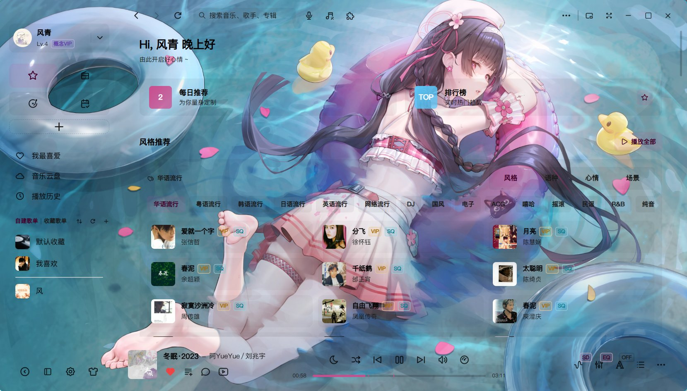
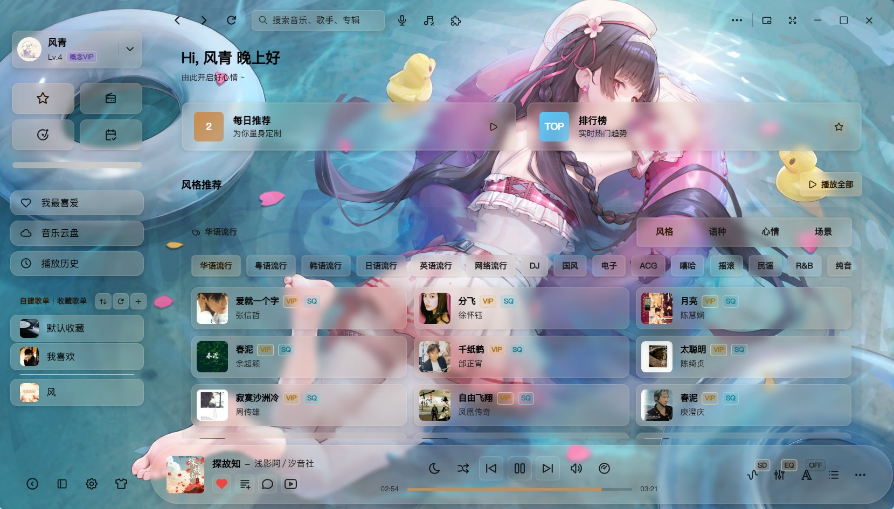
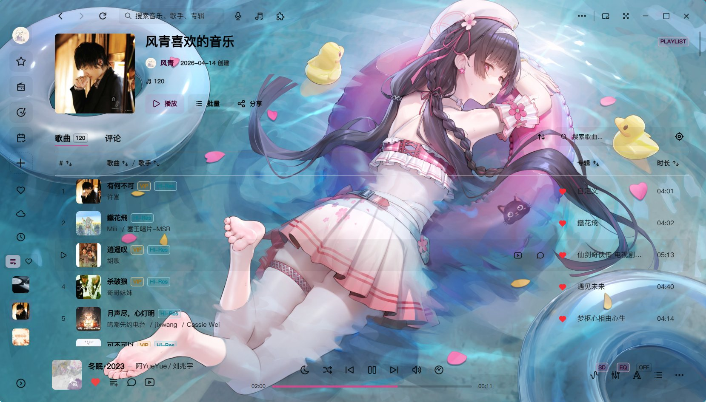
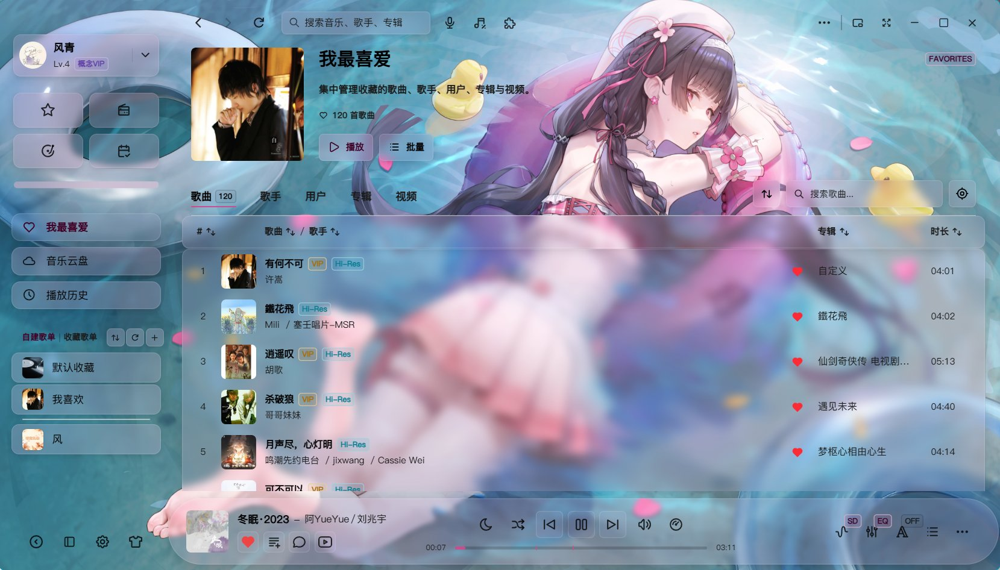
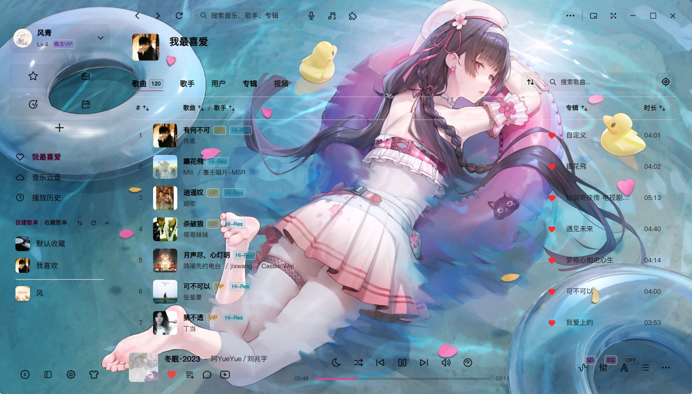
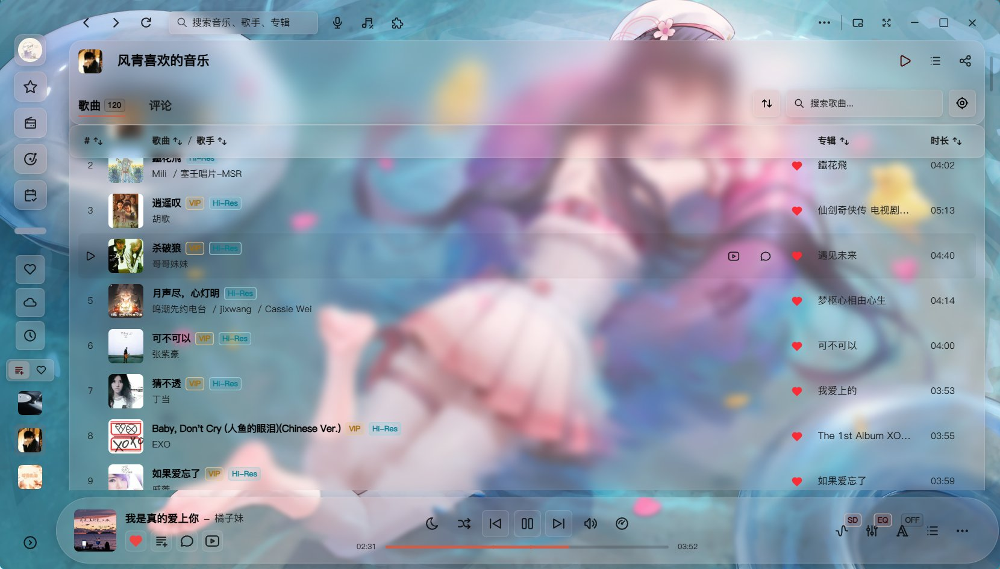
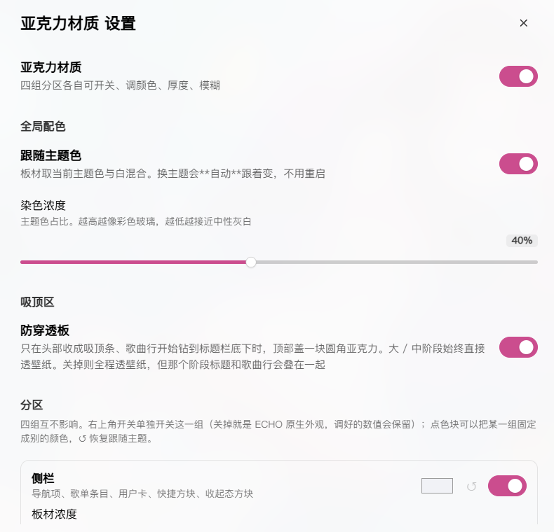
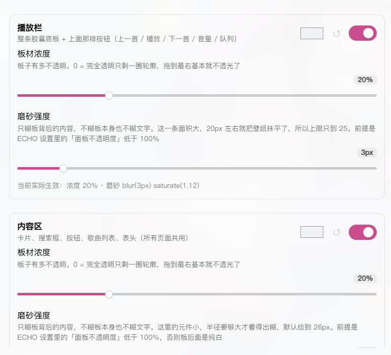
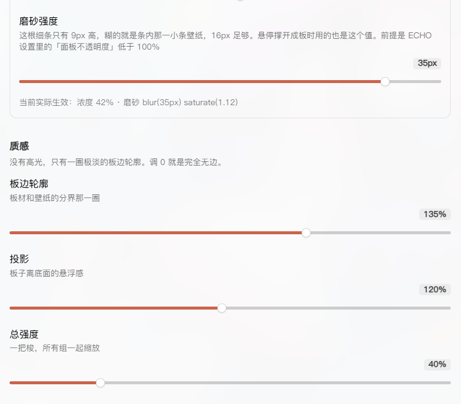

# 亚克力分层材质 · echo-acrylic

[](../../releases/latest)
[](LICENSE)

给 ECHO Music 的可交互元素铺一层**染色亚克力板材**：半透明底 + 背后磨砂 + 主题色染色。
**不改背景**——ECHO 自己的面板底色、透明度、壁纸全部照旧生效，材质只挂在能点、能拖、能输入的东西上。

> An acrylic-material plugin for ECHO Music. It only paints interactive elements (buttons, cards, list rows, the player
> capsule) — the wallpaper and ECHO's own surfaces are left untouched.

- 版本：`3.4.0`
- 要求：ECHO Music `>= 2.2.6-beta.9`

---

## 效果对比

同一张壁纸、同一个页面，**左：ECHO 原生 / 右：开启亚克力材质**。三组都拍在满屏花纹的深色壁纸上——壁纸越花，差别越明显。

### 一、首页：壁纸再花，控件也有落点

<p align="center">
  
  
</p>

**左（原生）**：图标、歌曲行、筛选词全部直接浮在壁纸和人物图案上，标题与「风格 / 心情 / 场景」被花纹切开，视线找不到落点。
**右（开启）**：每块能点的区域都有独立板材托底，壁纸从板后透出来，但不再穿过文字——层级一眼能读出来。

### 二、歌单列表：整块连续，不是一格一格

<p align="center">
  
  
</p>

**左（原生）**：歌曲行紧贴壁纸走，右侧专辑名和时长直接压在人物图案上，读完一行要费力找边界。
**右（开启）**：整张列表是一块连续板材，行与行靠分隔线区分，表头单独一层——远看是一整块玻璃，近看层级清楚。列表没有被拆成一个个小卡片。

### 三、滚动吸顶：滚到哪都压得住

<p align="center">
  
  
</p>

**左（原生）**：向下滚动后表头和歌曲行叠在一起，谁在上谁在下看不清。
**右（开启）**：只有当歌曲行真的钻进吸顶区，表头才落一层圆角板材；静止和头部展开时它完全透明，不挡壁纸。

### 为什么这样更"适配壁纸"

板材是**半透明染色 + 背后磨砂**，不是压一层实色：

- 壁纸始终看得见。换成浅色、深色、高对比还是满屏花纹，都不用回头改设置——所以它适配的是"任意壁纸"，不是只给某一张配好的背景
- 文字的对比度不再由壁纸亮度决定。板子在，字就稳；原来那种"压在人物腿上读不出来"的情况不会出现
- 磨砂只作用于板背后，不糊板本身也不糊文字，字始终是实的

### 四组独立，每一项都能单独调

<p align="center">
  
</p>

**总开关 + 全局配色**：一个开关管全部；换主题色时板材自动跟着变（`color-mix` 现算，不用重启）；染色浓度单独一根滑块。

**吸顶区**：防穿透板可单独关掉——关掉就全程透壁纸，代价是滚动那份标题会和歌曲行叠在一起。

<p align="center">
  
</p>

**四组分区，互不影响**：侧栏 / 播放栏 / 内容区 / 侧栏新建条，每张卡片右上角一个开关，下面各有一根板材浓度和一根磨砂强度，底部实时显示"当前实际生效"的真实值。

关掉一组不是"把浓度调到 0"——那样会留下描边和饱和提升，看着像关了一半。实际做法是整组规则不命中，元素 100% 回到 ECHO 原生外观，**调好的数值全部保留**，再打开还是原样。

<p align="center">
  
</p>

**新建条单独成组**：侧栏底部那根 ➕ 细线有自己的浓度和磨砂，不用连带调整个侧栏。

**质感三项**：板边轮廓（那条极淡的分界）、投影（悬浮感）、总强度（一把梭缩放所有组）。想要完全没有边，把轮廓调 0 就是。

---

## 它做什么

| 分区 | 覆盖的元素 |
|---|---|
| **侧栏** `sb` | 导航项、歌单条目、用户卡、快捷方块、收起态方块 |
| **播放栏** `pl` | 整条胶囊底板 + 上面那排按钮（上一首 / 播放 / 下一首 / 音量 / 队列） |
| **内容区** `ct` | 卡片、搜索框、按钮、歌曲列表、表头、个人主页数据条与会员卡（所有页面共用） |
| **新建条** `add` | 侧栏底部「+」那根细线（悬停会弹开成板） |

四组**互相独立**：各自有开关 + 颜色 + 浓度 + 磨砂。

## 它不做什么

- 不接管 ECHO 的 `--surface-*` 变量，不重画大面板底色（那是「换背景」，不是这个插件的事）
- 没有高光、没有渐变光泽、没有玻璃反光
- 不往列表里逐行叠卡片，整块列表是连续的一张板

---

## 安装

### 方式一：拖进插件管理（推荐）

1. 到 [Releases](../../releases/latest) 下载 `echo-acrylic-<版本>.zip`
2. 打开 ECHO → 顶栏「插件管理」
3. 把这个 zip **直接拖到插件管理页面**上，松手即安装
   （页面会提示"松开安装插件 · 支持 .zip 压缩包和插件文件夹"）
4. 装完点「刷新」，插件卡片出现即成功

不需要解压，也不用找 `%APPDATA%`。

### 方式二：手动放目录

插件放在 ECHO 的插件目录下，一个目录一个插件：

```
%APPDATA%\echo-music\plugins\echo-acrylic\
├── manifest.json
├── index.js
├── style.css
└── icon.svg
```

Windows 上是 `C:\Users\<你>\AppData\Roaming\echo-music\plugins\echo-acrylic\`。

把 zip 里的四个文件解压进去，重启 ECHO 即可。
（`README.md`、`LICENSE`、`.gitignore` 不用复制，宿主不读它们。）

### 升级

同样下载新版 zip 拖一次即可，宿主会覆盖旧版本。配置存在 ECHO 的设置库里，不会丢。

## 使用

顶栏「插件管理」→ 「亚克力分层材质」卡片 → 「设置」。

面板分四块：

- **亚克力材质** — 总开关
- **全局配色** — 跟随主题色（换主题自动重算，不用重启）、染色浓度
- **吸顶区** — 防穿透板：只有当列表行真的滚到吸顶标题底下时才显形，静止和头部展开时完全透明
- **分区** — 四张卡片，每张右上角是这一组的开关；点色块可把该组固定成别的颜色，`↺` 恢复跟随主题
- **质感** — 板边轮廓、投影、总强度（一把梭缩放所有组）

关掉某一组不会清数值：实现上是摘掉 `<html>` 上的 `acr-z-<key>` 类，那一组的 CSS 规则整体不命中，元素 100% 回到 ECHO 原生外观，改回来还是你调好的样子。

---

## 常见问题

**磨砂强度拖了没反应？**
先看你的背景是不是**纯色**。磨砂的实质是"把板背后的内容糊开"，背后是纯色时，模糊纯色还是纯色，视觉上必然零变化——四组滑块全都一样。
用带背景图的主题（ECHO 设置 → 外观 → 选图片背景）就能立刻看到效果。
自检办法：把「质感 → 板边轮廓」调大，能看到板边说明材质生效了，那就只是背景没有可糊的内容。

**所有插件突然都不生效了，界面上没有任何亚克力，日志里也没有报错？**
ECHO 被强杀（`taskkill /F`、任务管理器结束进程）后会把渲染进程判成崩溃，写进 `plugins:safe-mode = true`，之后**所有插件一律不加载**。
正常退出应用，再改 `%APPDATA%\echo-music\echomusic.sqlite` 的 `app_kv` 表：`plugins:safe-mode` 置为 `false`，重启即可。
这也意味着：不要用强杀进程的方式重启 ECHO。

**播放栏的磨砂看不出来 / 内容区个别页面没有板？**
播放栏默认上限只给到 25px —— 那条面积大，20px 左右就把壁纸抹平了。内容区按 ECHO 的页面结构挂载，某些弹层和第三方插件自绘的容器不在覆盖范围内。

---

## 实现要点（给想改的人）

- **材质用 `background-image` 叠，不动 `background-color`**：ECHO 的原生底色仍然可见，插件只是往上压一层半透明染色。这样切换主题、调面板透明度都不会打架。
- **变量用 `documentElement.style.setProperty(k, v, 'important')` 写**：inline important 高于任何选择器，滑块必定生效。早期版本用 `<style>` 注入 `:root{}`，特异性打不过样式表里 `html.acr-on:is(...)`，表现就是"拖了没反应"。
- **颜色不采样**：`--acr-dye` 直接是 `color-mix(in srgb, var(--color-primary) N%, white)`，交给浏览器算，主题色一变自动重算，不需要 MutationObserver。
- **`backdrop-filter` 会被 backdrop root 截断**：祖先上任何 `filter` / `isolation:isolate` / `clip-path` 都会让子元素的磨砂失效。内容区的 `.scrollbar-wrap` 因此被设成 `clip-path:none`。
- **吸顶遮挡带**：`--page-sticky-inset` 是吸顶区高度，板高要减去表头高度避免两层叠加；显形判定要**连续满足 140ms** 才认，否则 SPA 切页时 `scrollTop` 已更新、吸顶高度还滞后一 tick，会闪一下。

## License

MIT，见 [LICENSE](LICENSE)。
